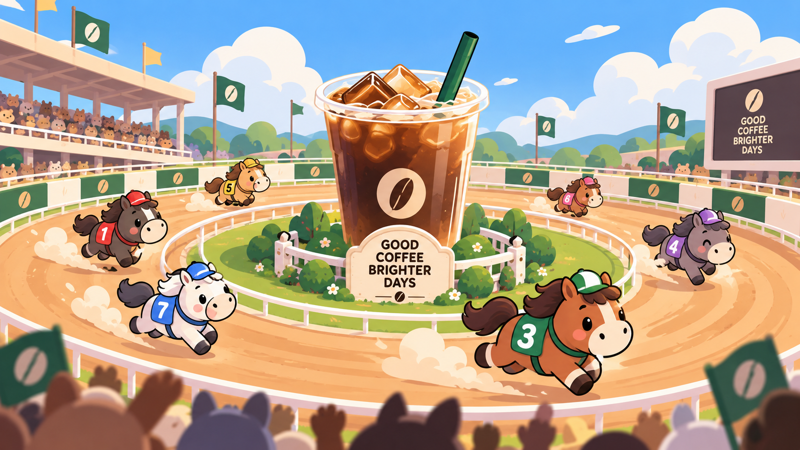
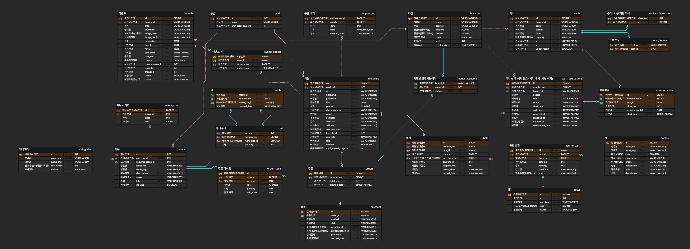

# 맨해튼 카페 (manhattaN cafe)

<div></div>
　

## 서비스 컨셉
#### 로열티 게이미피케이션(Loyalty Gamification) & 베버리지(Beverage)
- 주문 한번 시 쿠폰 1장
- 사이트에 손님이 제일 방문 많이하는 시간대에 경마를 열어서 그 전까지 쿠폰 배팅
- 자연스럽게 캐릭터도 말 캐릭터 같은거로 디자인을 꾸밀 수 있다
- 고객들이 가지고 있는 일정 매수만큼의 쿠폰을 경마종에 걸고 -> 경마종의 등수에 따라 쿠폰 차등 지급, 순위권 외의 경우 쿠폰을 건 만큼 차감
- 쿠폰을 많이 모으면 모을수록 각 메뉴에 대한 할인율 증가
- 쿠폰이 많은 사람이 메뉴를 사면 포인트 적립율 증가
- 포인트는 실제 메뉴 주문 시 사용 가능
- 일정 레벨을 해금해야 먹을 수 있는 시그니처 메뉴가 존재
  - 특정 레벨 단계마다 그 단계에 도달하면 시그니처 메뉴 오픈
  - 나머지는 잠금 아이콘

## 프로젝트 개요 및 개발 배경
### 개발 배경
- 기존의 쿠폰은 일반적으로, 쿠폰 10개를 모으면 1회의 메뉴(또는 서비스)를 제공해 준다.
  - 10장에 1회 서비스를 제공하는데, 9장 모여있으면 모아둔 쿠폰은 1장 더 모으기 전까진 의미가 없다.
- 쿠폰이 1장만 있어도 게임 등 즐길 수 있는 요소가 존재하는 서비스가 있으면 좋겠다는 니즈.

### 주요 기능
#### 게임 기능(말 경주)
- 쿠폰 내기
- 내기를 한 말의 성적에 따라 쿠폰 차등 지급 시스템
- 내기 후 쿠폰이 0개라면, 운영 재량에 따라 특정한 날에 게임에 사용할 수 있는 쿠폰을 1장 지급
- 말의 성향, 최근 성적, 컨디션 등을 확인할 수 있고, 사이트에서 제공하는 정보를 토대로 신중하게 말을 선택할 수 있다.
#### 좌석 예약 시스템
- 각 지점마다 혼잡도를 파악할 수 있다.
- 각 지점마다 혼잡도를 보고 원하는 지점에서 원하는 위치에 좌석을 예약할 수 있다.
- 시간대에 맞는 맞춤 좌석 추천

## 로고

<div></div>

### 로고 근거
https://en.wikipedia.org/wiki/Manhattan_Cafe
- 이렇게 'cafe'라는 단어가 붙은 이름의 실제 경주마가 있어서 채택
- 'N'cafe와도 이름이 부분적으로 일치 → ncafe의 연장선이라는 느낌

## 팀원 및 역할

| 팀원 (GitHub) | 주요 담당 | 작업 내용 |
| --- | --- | --- |
| [김승조](https://github.com/afterfrost999) | 좌석 예약, 메인 화면 연출 | • 좌석 예약: 날짜·지점·1시간 블록 선택 후 의자 단위 예약, 예약대기, 관리자 API<br>• 좌석 화면 백엔드 연결, 지점 정렬 순서와 지점별 평면도<br>• 예약 안내·예약대기 창에서 바로 로그인<br>• 메인 히어로 커피 레이스 애니메이션<br>• 좌석 예약 테스트 |
| [백승주](https://github.com/backsjj-bit) | 메뉴·카테고리, 찜, 회원 등급 | • 메뉴·카테고리 엔티티와 API, 지점별 판매 상태(판매 중·품절 등)<br>• 고객 메뉴판 백엔드 연결, 관리자 메뉴·카테고리 화면 연결, 관리자 변경 시 메뉴판 캐시 갱신<br>• 찜하기 서버 저장<br>• 누적 쿠폰 기준 회원 등급 계산, 등급별 메뉴 해금, 시그니처 메뉴<br>• 선택한 지점을 메뉴 상세·메인·마이페이지에 공유, 품절 표시 |
| [이동준](https://github.com/dongjun1580) | 회원, 권한 | • 회원 백엔드(가입·로그인·정보 수정·탈퇴)와 회원 화면 연동<br>• 본사 관리자·지점 관리자 권한 구분<br>• 지점 관리자 배정과 운영 기능(담당 지점 메뉴 판매 상태, 좌석·예약 관리)<br>• 회원 세션 로그인(Spring Security), CSRF 토큰 전달, API 프록시 경로 정리 |
| [임재현](https://github.com/hdown1241-commits) | 지점 관리 | • 지점 엔티티와 목록·상세 조회 API<br>• 관리자 지점 등록·수정 API와 관리자 화면<br>• 지점 등록·수정 요청의 CSRF 토큰 누락 수정 |
| [윤주상](https://github.com/JoostLean) | 프로젝트 기반, 경주·쿠폰·이벤트, 주문·결제 | • 프론트·백엔드 프로젝트 구조, 디자인 시스템(그레이스케일), 공통 레이아웃, 로고 적용<br>• 말 경주: 시각 기반 동시 진행, 카운트다운·시뮬레이션, 결과 순위, 지난 경주 기록, 경주 후 쿠폰 정산(연패 시 쿠폰 1장 지급)<br>• 이벤트, 마이페이지, 경주·이벤트 관리자 화면<br>• 장바구니·주문·결제(토스페이먼츠) 백엔드 연결<br>• PR 머지 등 브랜치 종합 관리 |

## ERD 설계



> 이미지가 작게 보이면 [원본 이미지](erd.png)를 열어 확대해서 확인.

### 표기 규칙
- **관리번호**: DB 내부에서 각 레코드를 식별하는 용도로 사용하는 `id`(또는 `no`)
- **번호**: 레코드를 순서대로 표시하는 용도로 사용하는 값(또는 실제 UI에 표시되는 값). 예) `races.no`, `race_horses.gate_no`

### 테이블 구성 (24개)

| 도메인 | 테이블 | 설명 |
| --- | --- | --- |
| 회원 | `members` | 회원 정보, 역할(`role`), 보유 쿠폰 수(`coupon_count`), 연패 횟수(`lose_streak`), 누적 획득 쿠폰(`total_earned_coupons`) |
| | `grade` | 등급 이름과 등급에 필요한 누적 쿠폰 수(`min_total_coupons`) |
| | `coupons_log` | 쿠폰 증감 내역(`delta`)과 사유(`note`) |
| 메뉴 | `categories` | 메뉴 카테고리 |
| | `menus` | 메뉴 기본 정보, 해금에 필요한 등급(`required_grade_id`), 삭제 여부 |
| | `menus_size` | 메뉴 사이즈별 가격 |
| | `menus_available` | 지점별 메뉴 판매 상태 (`branch_id` + `menu_id` 복합키) |
| | `wishes` | 회원의 찜 메뉴 |
| 주문·결제 | `cart` | 장바구니 (회원 + 메뉴 사이즈별 수량) |
| | `orders` | 주문 (회원, 총 주문 금액) |
| | `order_items` | 주문에 담긴 메뉴, 사이즈, 수량, 담은 시점의 가격 |
| | `payment` | 결제 수단·상태, 결제대행사 주문번호·트랜잭션ID |
| 지점 | `branches` | 지점 정보, 영업 여부, 평면도 구역(`sections`)과 시설(`fixtures`) JSON |
| 좌석 예약 | `seats` | 지점별 좌석 구역·유형·위치·수리 여부 |
| | `seat_features` | 좌석 특성 |
| | `seat_chair_repairs` | 수리·사용 제한 좌석(의자 번호) |
| | `seat_reservations` | 예약 상태(예약 완료·예약 대기·지난 예약), 인원, 시간대 |
| | `reservation_chairs` | 예약에 배정된 의자 |
| 경주·베팅 | `horses` | 말 정보(이름, 색, 성향 등) |
| | `races` | 경기 (출발 시각, 시드, 진행 상태) |
| | `race_horses` | 경기별 출전마 (게이트 번호, 순위, 컨디션, 적중 유형) |
| | `bets` | 회원의 베팅 (건 쿠폰, 지급 쿠폰, 정산 일시) |
| 이벤트 | `events` | 이벤트 정보, 쿠폰 지급 여부·수량, 정원, 진행 상태 |
| | `events_applies` | 이벤트 참여 이력 |

### 설계 포인트
- **회원 → 등급**: `members.grade_id`가 `grade`를 참조한다. 등급은 누적 쿠폰(`total_earned_coupons`)으로 결정되고, `menus.required_grade_id`로 등급별 메뉴 해금과 시그니처 메뉴를 표현한다.
- **지점별 판매 상태**: 메뉴 자체(`menus`)와 지점별 판매 여부(`menus_available`)를 분리해서, 같은 메뉴를 지점마다 판매 중·품절로 다르게 둘 수 있다.
- **좌석 예약**: 예약(`seat_reservations`) 하나에 의자 여러 개(`reservation_chairs`)가 연결된다. 좌석 구역은 `TRACKSIDE`(창가), `GRANDSTAND`(일반), `LOUNGE`(단체), `PADDOCK`(바)이고, 좌석 특성(`seat_features.feature`)은 `WINDOW`, `OUTLET`, `QUIET`, `NEAR_COUNTER`, `BAR` 등이다.
- **경주**: 경기(`races`)와 말(`horses`)은 출전마(`race_horses`)로 연결되고, 베팅(`bets`)은 경기와 출전마를 함께 참조해서 순위에 따른 쿠폰 정산 근거가 된다.
- **쿠폰 변동 추적**: 쿠폰 보유량은 `members`에 두고, 모든 증감은 `coupons_log`에 남긴다.

## 기술 스택

| 구분 | 기술 | 버전 | 용도 |
| --- | --- | --- | --- |
| 프론트엔드 | Next.js (App Router) | 16.4.3 | 화면 렌더링, `/api/v1/*` 백엔드 프록시, 경주 순위 계산 Route Handler |
| | React | 19.3.1 | UI |
| | TypeScript | 5 | 타입 안전성 |
| | PixiJS | 8.x | 경주 화면(WebGL 캔버스) |
| | 토스페이먼츠 SDK | 2.x | 결제창 |
| | ESLint / Playwright | 9 / 1.x | 코드 검사 / 브라우저 테스트 |
| 백엔드 | Java | 21 | 언어 |
| | Spring Boot | 4.1.2 | 웹 API |
| | Spring Security | Boot 포함 | 세션 로그인, CSRF, 본사·지점 관리자 권한 |
| | Spring Data JPA (Hibernate) | Boot 포함 | ORM |
| | Lombok | - | 보일러플레이트 제거 |
| | Gradle | Wrapper | 빌드 |
| 데이터베이스 | H2 (메모리) | - | 로컬 개발·테스트 (설치 불필요) |
| | PostgreSQL | 17 | 개발·운영 (Docker Compose 제공) |
| 외부 서비스 | 토스페이먼츠 | - | 주문 결제 |

### 시스템 구조

```
브라우저 ──▶ Next.js (3000) ──/api/v1/*──▶ Spring Boot (8080) ──▶ H2 / PostgreSQL
                │                                  │
                └── /api/race-ranking ◀────────────┘  (경주 순위 계산 요청)
```

- 브라우저는 Next.js 한 곳(3000번)만 호출한다. `/api/v1/*` 요청은 Next.js가 Spring으로 넘기므로 세션 쿠키가 그대로 오가고 CORS 설정이 필요 없다.

## 실행 방법

### 0. 준비물

| 항목 | 필요한 경우 |
| --- | --- |
| JDK 21 | 필수 |
| Node.js 20 이상 | 필수 |
| Docker Desktop | PostgreSQL로 실행할 때만 |

### 1. 백엔드 실행 (터미널 1)

별도 설정 없이 실행하면 DB를 따로 설치하지 않는 H2 메모리 DB를 사용한다. 처음에는 이 방법을 권장한다.

```bash
cd backend
./gradlew bootRun      # macOS / Linux / Git Bash
.\gradlew.bat bootRun  # Windows PowerShell
```

- 실행하면 지점·메뉴·출전마·이벤트·좌석·본사 관리자 계정 같은 초기 데이터가 자동으로 들어간다.
- 서버를 끄면 데이터가 모두 사라지고, 다시 켜면 초기 상태로 시작한다.
- 지점 관리자 테스트 계정(아래 4번 표)까지 필요하면 `h2` 프로필을 붙인다: `./gradlew bootRun --args='--spring.profiles.active=h2'`

PostgreSQL로 실행하려면 아래처럼 한다.

```powershell
cd backend
$env:DB_PASSWORD = '개발용 비밀번호'
docker compose up -d
.\gradlew.bat bootRun --args='--spring.profiles.active=dev'
```

### 2. 프론트엔드 실행 (터미널 2)

```bash
cd frontend
npm install
npm run dev
```

브라우저에서 http://localhost:3000 에 접속한다. **localhost와 127.0.0.1을 섞어 쓰면 로그인 세션이 풀리니 한쪽으로만 접속한다.**

### 3. 결제 테스트 설정 (선택)

주문·결제를 써 보려면 `frontend/.env.local` 파일을 만들고 토스페이먼츠 테스트용 클라이언트 키를 넣는다. 이 파일은 저장소에 올리지 않는다.

```
NEXT_PUBLIC_TOSS_CLIENT_KEY=토스페이먼츠 개발자센터의 테스트 클라이언트 키
```

백엔드의 시크릿 키는 기본으로 토스 문서의 테스트 키가 들어 있어 따로 설정하지 않아도 된다.

### 4. 테스트 계정 (H2 프로필)

| 역할 | 아이디 | 비밀번호 |
| --- | --- | --- |
| 본사 관리자 | `e2eadmin` | `e2e-admin-pass` |
| 마포 지점 관리자 | `test_mapo_admin` | `branch-admin-pass` |
| 강남 지점 관리자 | `test_gangnam_admin` | `branch-admin-pass` |
| 성수 지점 관리자 | `test_seongsu_admin` | `branch-admin-pass` |

일반 고객은 http://localhost:3000/signup 에서 직접 가입한다.

### 5. 주요 화면

| 주소 | 내용 |
| --- | --- |
| `/` | 메인 (커피 레이스 히어로) |
| `/menu` | 메뉴판 |
| `/race` | 경주 |
| `/seat` | 좌석 예약 |
| `/my` | 마이페이지 |
| `/admin/...` | 관리자 화면 (관리자 계정으로 로그인) |

### 6. 테스트·빌드

```bash
cd backend && ./gradlew test        # 백엔드 테스트
cd frontend && npm run lint         # 코드 검사
cd frontend && npm run test:member  # 회원 화면 브라우저 테스트(Playwright)
cd frontend && npm run build        # 운영 빌드 (백엔드를 먼저 실행해 둔다)
```

### 자주 겪는 문제

| 증상 | 원인과 해결 |
| --- | --- |
| 백엔드가 DB 연결 오류로 종료됨 | `--spring.profiles.active=h2`를 빠뜨렸다. |
| 화면에 메뉴·지점이 비어 있음 | 백엔드가 꺼져 있다. 백엔드를 먼저 켠다. |
| 로그인했는데 곧바로 풀림 | localhost와 127.0.0.1을 섞어 접속했다. 한쪽으로 통일한다. |
| 백엔드 주소를 바꿨는데 반영 안 됨 | `BACKEND_URL`은 빌드 때 정해진다. 프론트를 다시 빌드·재시작한다. |
