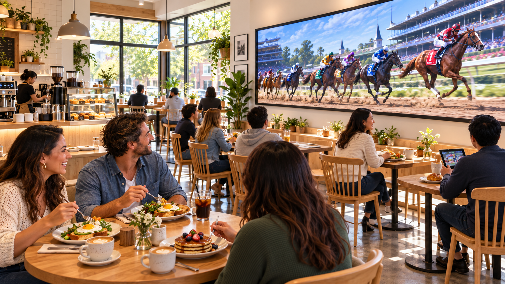
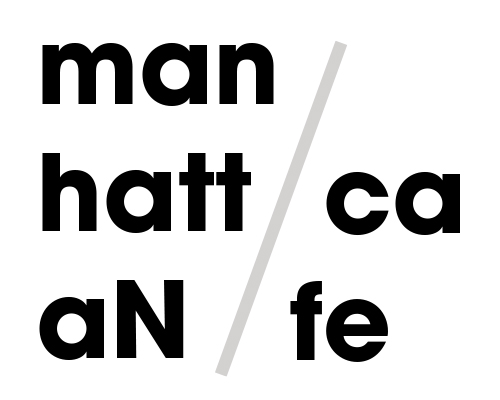

# 맨해튼 카페 (manhattaN cafe)

　

## 서비스 컨셉
#### 게이미피케이션 기반 로열티 프로그램(Gamified Loyalty Program)
- 주문 한번 시 쿠폰 1장
- 사이트에 손님이 제일 방문 많이하는 시간대에 경마를 열어서 그 전까지 쿠폰 배팅
- 자연스럽게 캐릭터도 말 캐릭터 같은거로 디자인을 꾸밀 수 있다
- 고객들이 가지고 있는 일정 매수만큼의 쿠폰을 경마종에 걸고 -> 경마종의 등수에 따라 쿠폰 차등 지급, 순위권 외의 경우 쿠폰을 건 만큼 차감
- 쿠폰을 많이 모으면 모을수록 각 메뉴에 대한 할인율 증가
- 쿠폰이 많은 사람이 메뉴를 사면 포인트 적립율 증가
- 포인트는 실제 메뉴 주문 시 사용 가능
- 일정 레벨을 해금해야 먹을 수 있는 시그니처 메뉴가 존재
  - 특정 레벨 단계마다 그 단계에 도달하면 시그니처 메뉴 오픈
  - 나머지는 잠금 아이콘

## 프로젝트 개요 및 개발 배경
### 개발 배경
- 기존의 쿠폰은 일반적으로, 쿠폰 10개를 모으면 1회의 메뉴(또는 서비스)를 제공해 준다.
  - 10장에 1회 서비스를 제공하는데, 9장 모여있으면 모아둔 쿠폰은 1장 더 모으기 전까진 의미가 없다.
- 쿠폰이 1장만 있어도 게임 등 즐길 수 있는 요소가 존재하는 서비스가 있으면 좋겠다는 니즈.

### 주요 기능
#### 게임 기능(말 경주)
- 쿠폰 내기
- 내기를 한 말의 성적에 따라 쿠폰 차등 지급 시스템
- 내기 후 쿠폰이 0개라면, 운영 재량에 따라 특정한 날에 게임에 사용할 수 있는 쿠폰을 1장 지급
- 말의 성향, 최근 성적, 컨디션 등을 확인할 수 있고, 사이트에서 제공하는 정보를 토대로 신중하게 말을 선택할 수 있다.
#### 좌석 예약 시스템
- 각 지점마다 혼잡도를 파악할 수 있다.
- 각 지점마다 혼잡도를 보고 원하는 지점에서 원하는 위치에 좌석을 예약할 수 있다.
- 시간대에 맞는 맞춤 좌석 추천

## 로고

### 로고 근거
https://en.wikipedia.org/wiki/Manhattan_Cafe
- 이렇게 'cafe'라는 단어가 붙은 이름의 실제 경주마가 있어서 채택
- 'N'cafe와도 이름이 부분적으로 일치 → ncafe의 연장선이라는 느낌
